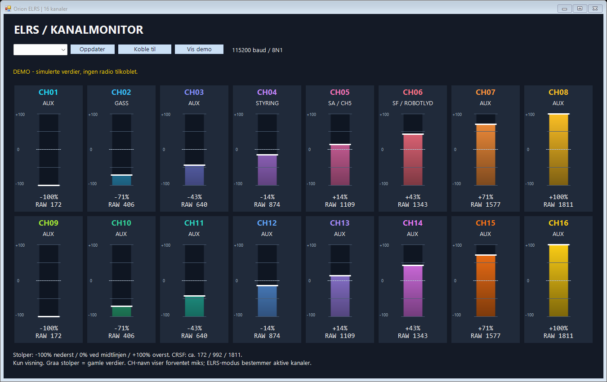

# Makeblock Orion med ExpressLRS

Fjernstyrt Makeblock Starter Kit-belterobot med Orion, Matek R24-D og RadioMaster TX15 Max. Prosjektet inneholder Arduino-kode, en grafisk Windows-monitor og komponentdokumentasjon.

## Gjeldende status

- Venstre X styrer via CH4; høyre Y gir frem/revers via CH2.
- SA armerer via CH5. SF på CH6 utløser en kort, komisk robotlyd.
- Sving på stedet støttes. Fartsgrensen er 160 av 255.
- Beltekompensasjonen er fjernet.
- **Ultralydavlesning og automatisk hindringsstopp er deaktivert.** IR-enheten brukes ikke i koden.
- Motorretning og spakretning er tilpasset roboten i dette prosjektet. Kontroller dem før bruk på en annen robot.

## Innhold

| Mappe eller fil | Innhold |
| --- | --- |
| `ChannelMonitor/` | Arduino-program som leser 16 CRSF-kanalfelt og skriver dem som tekst |
| `GraphicMonitor/` | Grafisk Windows-monitor med fargede stolper og utjevning |
| `docs/Makeblock_Orion_komponenter_og_begrensninger.docx` | Komponentoversikt og begrensninger |
| `docs/KOBLINGER.md` | Kabling, kanaloppsett og kjente begrensninger |

## Maskinvare

- Makeblock Orion, velg **Arduino Uno** i Arduino IDE.
- To 6 V DC-girmotorer, oppgitt til 185 rpm, 25 mm og girforhold 1:46.
- Matek R24-D ExpressLRS-mottaker, bundet til TX15 Max.
- Mottakerens **UART Baud = 115200**, vanlig ikke-invertert CRSF.
- Ultralydsensor i port 3, IR-enhet i port 7 og ELRS i port 5.
- Seks alkaliske 1,5 V-batterier i serie, 9 V nominelt. PWM er ikke en regulert 6 V-forsyning.

## Kjøreprogram

RobotControl er fjernet fra repoet. Beskrivelsen av kjøreoppsettet nedenfor er beholdt som prosjektinformasjon; kjøreprogrammet følger ikke med.

## Radioens Mixes

| Kanal | Fysisk kontroll | Funksjon |
| --- | --- | --- |
| CH2 | Høyre Y | Frem og revers |
| CH4 | Venstre X | Sving, også på stedet |
| CH5 | SA | Armering, høy verdi bare i ønsket armert-stilling |
| CH6 | SF | Robotlyd ved overgang fra lav til høy verdi |

Orion mottar kanalverdier, ikke bryternavn. For å bruke SF må CH6-kilden settes til SF i radioen; en gammel SB-miks på samme kanal må fjernes. SF må settes av før første lydaktivering. Sett kortets fysiske BUZZER-bryter til ON.

## Grafisk kanalmonitor

1. Last opp `ChannelMonitor/ChannelMonitor.ino`. Behold `CrsfRx.h` i samme mappe.
2. Lukk Arduino Seriell monitor.
3. På Windows: start `GraphicMonitor/Start-Monitor.cmd`, velg COM-port og koble til.

Monitoren bruker Windows PowerShell 5.1 og .NET Framework. Ingen Python eller ekstra pakker trengs. Alle 16 kanalfelt vises omtrent 20 ganger per sekund; ELRS-modus bestemmer hvilke kanaler som faktisk oppdateres over radio. Bare stolpene utjevnes, ikke råverdiene. Demo kan brukes uten robot.

Kjøreprogrammet og kanalmonitorprogrammet lastes opp hver for seg. Grafikkprogrammet kan ikke tolke kjøreprogrammets diagnostikklinjer.

## Testing og begrensninger

- Armering, kanalavlesning, grunnleggende kjøring og grafikk er tidligere funksjonstestet av eier. Senere lydeffekter og alle versjonsendringer er ikke fullstendig maskinvaretestet.
- Grafikken og animasjonen er kontrollert lokalt. Animasjonstest: `powershell.exe -NoProfile -STA -ExecutionPolicy Bypass -File .\GraphicMonitor\Test-Animation.ps1`.
- Opplastings- og driftskontroll på faktisk Orion gjenstår for hver ny versjon; det foreligger ingen komplett automatisert AVR-byggverifikasjon.
- Ingen hjulenkodere, strømovervåking, batterivarsel eller automatisk kurskorrigering brukes.
- Signalbruddsstopp fjerner motorpådrag etter 250 ms uten gyldige kanalrammer, pluss eventuell deteksjonstid i mottakeren. Det er ikke en uavhengig fysisk nødstopp.

## Samarbeid

Gjør endringer på en egen gren og åpne en pull request. Oppgi hvilke filer som er endret, og hva som faktisk er testet. Avtal hvem som tester ny robotkode før endringene tas i bruk. Ikke legg inn ELRS-bindingsfrase, passord eller tilgangstokens i repoet.

Repoets eier må gi lagkameraten tilgang i GitHub under **Settings → Collaborators** dersom nødvendig. Opplasting av filer endrer ikke automatisk tilgangene.
